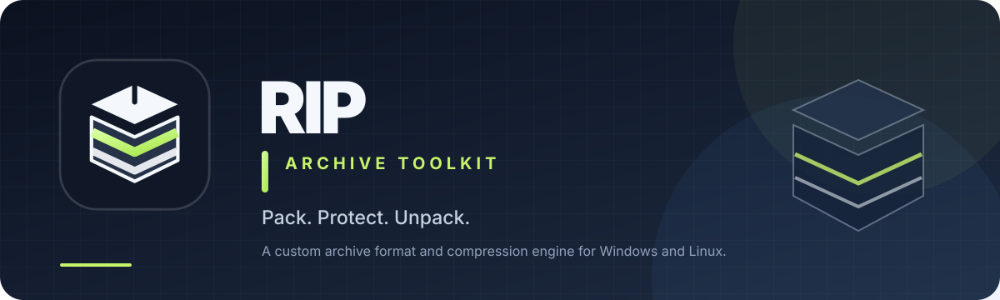

# RIP Archive Toolkit

<p align="center">
  
</p>

<p align="center">
  <a href="https://github.com/Cooper-Src/rip/actions/workflows/release.yml">
    
  </a>
  <a href="https://github.com/Cooper-Src/rip/releases">
    
  </a>
  <a href="https://github.com/Cooper-Src/rip/blob/main/LICENSE">
    
  </a>
  
  
</p>

RIP is a C++23 archive utility with a command-line interface and a graphical archive manager built using Qt 6 and Qt WebEngine. It creates, lists, tests, and extracts its own `.rip` archive format.

RIP includes **RIPC**, a custom LZ-style compression codec with token encoding and Huffman entropy coding. During archive creation, each file is evaluated using STORE, DEFLATE, and RIPC, and the archive stores the smallest completed representation. RIPC's automatic mode compares Fast, Balanced, Maximum, and Ultra search profiles and keeps the smallest resulting stream. The matcher uses a fixed-endian multiplicative hash; Ultra estimates encoded distance and extended-length costs when choosing matches. Large inputs use independent 2 MiB chunks to reduce repeated per-chunk entropy-coding overhead, without changing the RIPC v11 stream format.

> **Project status:** RIP and the `.rip` format are actively developed. The format and codec may change as the project evolves.

## Brand identity

RIP uses a compact geometric archive mark with a carbon-and-slate base and a lime accent. The source SVGs, wordmark, README banner, app icon, and usage rules live in the [branding directory](branding/). The same mark appears in the desktop titlebar, favicon, Windows executable, and installer.

## Features

- Custom `.rip` archive format with explicit binary serialization.
- Command-line utility and Qt-based graphical archive manager.
- Windows ARM64 and x64 builds, plus Linux ARM64 and x86-64 builds.
- Adaptive per-file STORE, DEFLATE, and RIPC compression.
- Faster RIPC four-byte match hashing to reduce encoder overhead without changing the RIPC v11 stream format.
- Cost-aware RIPC Ultra match selection, weighing distance reuse and extended-length overhead rather than blindly choosing only the longest match.
- 2 MiB parallel RIPC v11 chunks for lower repeated entropy-coding overhead; Auto still selects the smallest result across all four profiles.
- Parallel decompression of RIPC's independent chunks and bulk expansion of overlapping LZ matches.
- CRC32 checksums and archive integrity testing.
- Browse the filesystem and open/browse RIP archives in the GUI.
- Create, extract, test, inspect, and delete archives through the GUI.
- Archive creation dialog with file-level progress and a second byte-level progress bar. The byte bar reports the current reading/compression phase so it can continue moving while a large file is still being processed.
- Separate, architecture-specific Windows and Linux release packages, including guided Inno Setup installers for Windows x64 and ARM64 plus native Debian and RPM packages for Linux x86-64 and ARM64.
- GitHub Actions builds, compression tests, archive round-trip tests, and release packaging.

## Download

Get the latest packages from the [GitHub Releases page](https://github.com/Cooper-Src/rip/releases).

The current release is **v1.1.12**:

| Platform | Download |
| --- | --- |
| Windows ARM64 | [rip-1.1.12-windows-arm64.zip](https://github.com/Cooper-Src/rip/releases/download/v1.1.12/rip-1.1.12-windows-arm64.zip) |
| Windows ARM64 installer | [rip-1.1.12-windows-arm64-setup.exe](https://github.com/Cooper-Src/rip/releases/download/v1.1.12/rip-1.1.12-windows-arm64-setup.exe) |
| Windows x64 | [rip-1.1.12-windows-x64.zip](https://github.com/Cooper-Src/rip/releases/download/v1.1.12/rip-1.1.12-windows-x64.zip) |
| Windows x64 installer | [rip-1.1.12-windows-x64-setup.exe](https://github.com/Cooper-Src/rip/releases/download/v1.1.12/rip-1.1.12-windows-x64-setup.exe) |
| Linux ARM64 / AArch64 (Debian/Ubuntu) | [rip_1.1.12_arm64.deb](https://github.com/Cooper-Src/rip/releases/download/v1.1.12/rip_1.1.12_arm64.deb) |
| Linux x64 / x86-64 (Debian/Ubuntu) | [rip_1.1.12_amd64.deb](https://github.com/Cooper-Src/rip/releases/download/v1.1.12/rip_1.1.12_amd64.deb) |
| Linux ARM64 / AArch64 (Fedora/RHEL) | [rip-1.1.12-1.aarch64.rpm](https://github.com/Cooper-Src/rip/releases/download/v1.1.12/rip-1.1.12-1.aarch64.rpm) |
| Linux x64 / x86-64 (Fedora/RHEL) | [rip-1.1.12-1.x86_64.rpm](https://github.com/Cooper-Src/rip/releases/download/v1.1.12/rip-1.1.12-1.x86_64.rpm) |
| Linux ARM64 portable | [rip-1.1.12-linux-aarch64.tar.gz](https://github.com/Cooper-Src/rip/releases/download/v1.1.12/rip-1.1.12-linux-aarch64.tar.gz) |
| Linux x64 portable | [rip-1.1.12-linux-x86_64.tar.gz](https://github.com/Cooper-Src/rip/releases/download/v1.1.12/rip-1.1.12-linux-x86_64.tar.gz) |

### Windows

Each Windows ZIP contains:

- `rip.exe` — command-line utility.
- `rip-gui.exe` — graphical archive manager.
- `gui/` — the GUI's web assets.
- Bundled Qt libraries, plugins, and Qt WebEngine runtime files.

The Windows packages are designed to run without a separate Qt installation. For a guided setup, download the architecture-matched `*-setup.exe` installer. It installs per-user under `%LOCALAPPDATA%\Programs\RIP`, creates a Start Menu shortcut, and offers an optional desktop shortcut. The ZIP remains available as a portable option: extract it and launch `rip-gui.exe` or use `rip.exe` from a terminal.

### Linux

For Ubuntu 24.04+ and compatible Debian-based systems, install the matching `.deb` package with `sudo apt install ./rip_1.1.12_amd64.deb` (use `rip_1.1.12_arm64.deb` on ARM64). For Fedora and compatible RPM-based distributions, install the matching `.rpm` with `sudo dnf install ./rip-1.1.12-1.x86_64.rpm` (use the `aarch64` package on ARM64). These packages add the CLI to `/usr/bin`, a RIP Archive Toolkit entry to the desktop application menu, and the branded app icon. Runtime dependencies are declared in the package metadata, including Qt 6 WebEngine; your distribution must provide a compatible Qt 6 runtime.

Portable tarballs are also provided for both architectures. Extract the archive, enter the versioned directory it creates, then run `./usr/bin/rip` for CLI use or `./usr/bin/rip-gui` for the GUI. Keep the extracted directory structure intact so the launcher can find its GUI runtime assets.

## Command-line usage

The commands below work with the `rip` executable (use `rip.exe` in Windows terminals if it is not on your PATH).

### Create an archive

Create an archive from a directory:

```powershell
rip create archive.rip C:\Path\To\Folder
```

Or from a single file:

```powershell
rip create archive.rip C:\Path\To\file.txt
```

### List archive contents

```powershell
rip list archive.rip
```

### Test an archive

```powershell
rip test archive.rip
```

Testing validates the archive structure, decompresses its entries, and checks their CRC32 checksums.

### Extract an archive

```powershell
rip extract archive.rip C:\Output\Folder
```

### Show help

```powershell
rip --help
```

The CLI commands currently available are `create`, `list`, `test`, `extract`, and `help`. Archive information and filesystem/archive browsing are available in the GUI.

## GUI

Run `rip-gui.exe` on Windows, or `rip-gui` on Linux after installing a package. From an extracted Linux tarball, launch `./usr/bin/rip-gui` inside the versioned directory.

The GUI is a file-manager-style interface. It can browse the filesystem, open and browse RIP archives, create archives, extract and test them, view archive information, and delete selected files or archives.

When creating an archive, the dialog shows two progress indicators:

- **File progress** tracks the archive's overall file/stage progress.
- **Byte progress** shows bytes processed against the current file's size, along with the current pass (such as reading, DEFLATE, or an RIPC search pass). This provides activity feedback even when one large file keeps the file count unchanged.

## Building from source

### Requirements

- C++23 compiler and toolchain.
- CMake 3.25 or newer.
- Git (CMake fetches and builds zlib-ng as part of the configuration).
- Qt 6 development packages containing **Core, Gui, Widgets, WebChannel, WebEngineCore, and WebEngineWidgets**.
- Node.js 22 and npm are needed only when rebuilding the TypeScript/Vite frontend or when running the release workflow.

The checked-in GUI assets under `gui/dist/` are copied into the build output automatically. If you edit the frontend sources under `gui/src/`, rebuild those assets first:

```bash
cd gui
npm ci
npm run build
cd ..
```

### Windows ARM64

With Visual Studio 2026 Build Tools and a matching Qt 6 installation:

```powershell
cmake -S . -B build -G "Visual Studio 18 2026" -A ARM64
cmake --build build --config Release --parallel
```

### Windows x64

```powershell
cmake -S . -B build -G "Visual Studio 18 2026" -A x64
cmake --build build --config Release --parallel
```

The selected Qt installation must match the target architecture and compiler. RIP also includes convenience scripts under `scripts/` for common builds.

### Linux

On Ubuntu/Debian-based systems, install the build dependencies first:

```bash
sudo apt-get update
sudo apt-get install -y \
  cmake ninja-build build-essential git \
  qt6-base-dev qt6-webengine-dev qt6-webchannel-dev
```

Then configure and build:

```bash
cmake -S . -B build-linux -G Ninja -DCMAKE_BUILD_TYPE=Release
cmake --build build-linux --parallel
```

Or run the helper script:

```bash
./scripts/build-linux.sh
```

Both `rip` and `rip-gui` are build targets. For other distributions, install the equivalent Qt 6 development packages for the components listed above.

## Testing

The project includes dedicated token-codec, token-Huffman, and compression tests. After configuring and building:

Windows:

```powershell
cmake --build build --config Release --target rip-token-codec-test
cmake --build build --config Release --target rip-token-huffman-test
cmake --build build --config Release --target rip-compression-test
.\build\Release\rip-token-codec-test.exe
.\build\Release\rip-token-huffman-test.exe
.\build\Release\rip-compression-test.exe
```

Linux (adjust `build` if you used a different build directory):

```bash
cmake --build build-linux --target rip-token-codec-test rip-token-huffman-test rip-compression-test
./build-linux/rip-token-codec-test
./build-linux/rip-token-huffman-test
./build-linux/rip-compression-test
```

GitHub Actions builds the GUI frontend, runs the compression tests and CLI archive round-trip checks, compiles both Windows installer architectures with Inno Setup, and publishes the resulting installers and portable packages in each release.

## RIPC compression

RIPC combines LZ-style match finding with token encoding and Huffman entropy coding. Inputs up to 2 MiB keep the single-stream layout. Automatic mode tests Fast, Balanced, Maximum, and Ultra profiles. Larger inputs split into independent 2 MiB chunks and compress them concurrently, using up to the number of logical CPU threads reported by the operating system (bounded by the chunk count). Auto mode compares all four profiles per chunk; explicit profiles only run their selected search. Larger chunks reduce repeated per-chunk headers and entropy-coding overhead, although any independent chunk boundary can miss a match that crosses it. Ultra accounts for the two-byte cost of a new match distance and the extended-length field when choosing between candidates. The 2 MiB chunk strategy and cost-aware Ultra matcher are included in v1.1.11.

RIP then compares the chosen RIPC result with DEFLATE and STORE for each file. RIPC is **not guaranteed to be smaller or faster for every input**; if another representation is smaller, RIP stores that instead. The stream format is now v11 for this parallel-chunk encoder, so older RIP binaries that do not support v11 cannot decompress newly created RIPC v11 streams. The codec is still under active development.

## Archive format

RIP uses a custom binary format with explicit serialization instead of compiler-dependent struct layouts. Archive metadata includes the format version, flags, index location and size, file offsets and sizes, CRC32 checksums, compression methods, and archive paths. Archives may use solid RIPC when the archive engine determines that it is beneficial.

The format, GUI, and codec are still evolving; do not assume permanent compatibility between every development version.

## Releases

Release versions are coordinated by `CMakeLists.txt` and `RELEASE_VERSION`. To prepare a new release:

1. Update the project version in `CMakeLists.txt`.
2. Set `RELEASE_VERSION` to the matching tag (for example, `v1.1.11`).
3. Commit both version changes to `main`.

After the commit passes the RIPC test workflow, GitHub Actions creates the matching version tag and dispatches the full platform release workflow. That workflow rebuilds the frontend, builds and tests Windows ARM64/x64 and Linux ARM64/x86-64, packages the platform artifacts, and publishes the GitHub Release.

See the [release workflow](https://github.com/Cooper-Src/rip/actions/workflows/release.yml) and the [tagging workflow](https://github.com/Cooper-Src/rip/actions/workflows/tag-release.yml) for details.

## Dependencies and license

RIP uses:

- [zlib-ng](https://github.com/zlib-ng/zlib-ng), built in zlib-compatible mode, for DEFLATE-compatible compression.
- [Qt 6](https://www.qt.io/) and Qt WebEngine / WebChannel for the graphical interface.

RIP is licensed under the [MIT License](LICENSE). Third-party components are subject to their own licenses.
